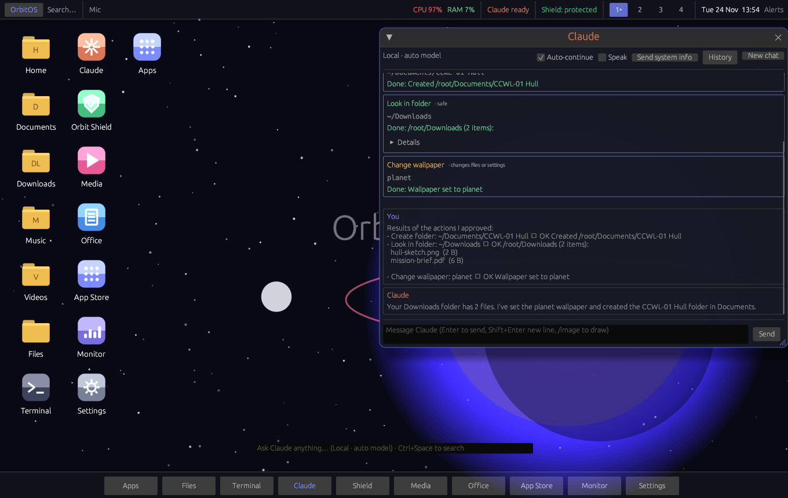
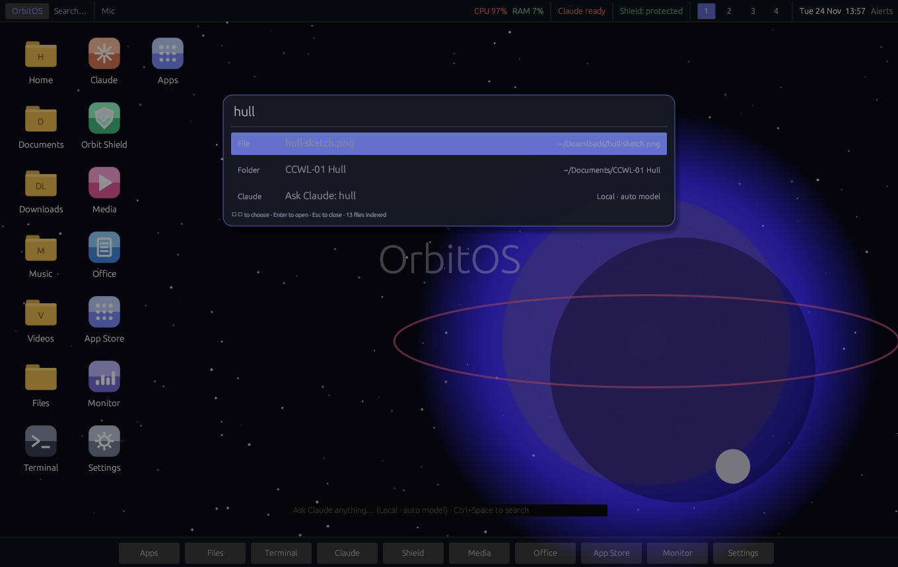
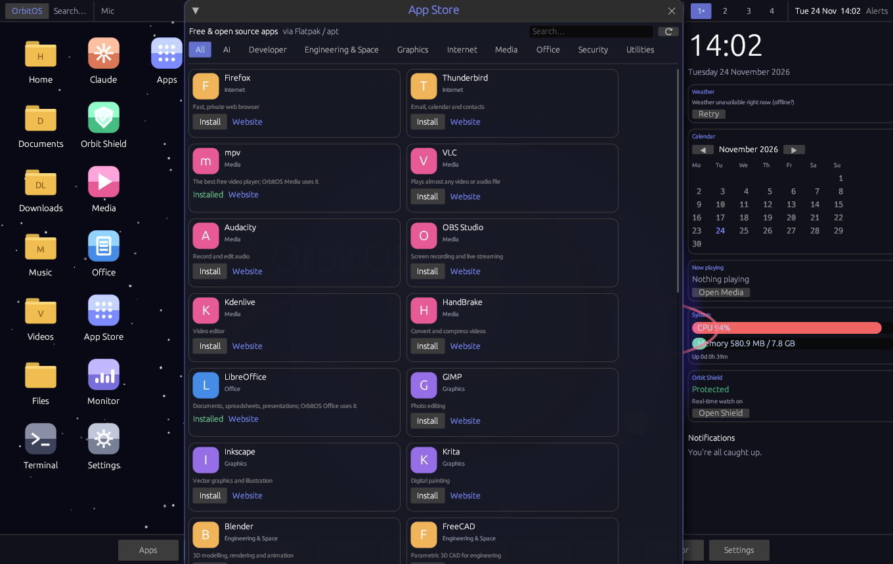
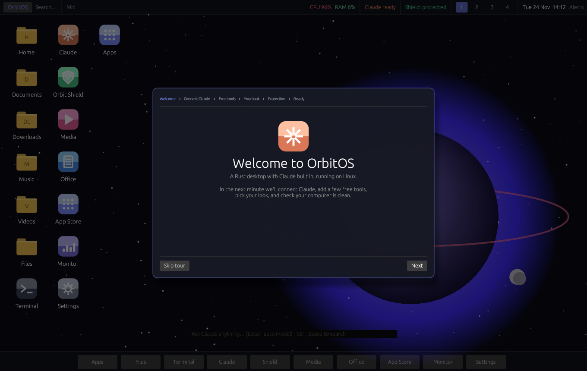
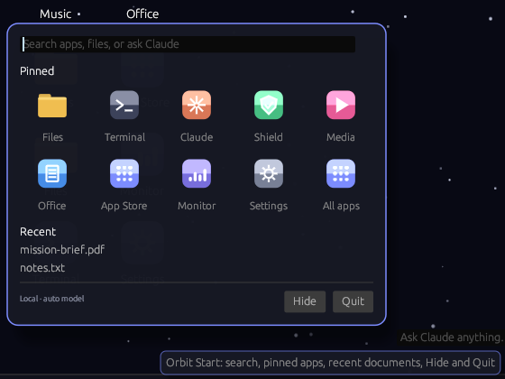

# OrbitOS

> Orbit is an operating system experience that works on Windows, Linux and Mac with Claude AI built in.

A desktop environment and shell written in Rust, with Claude built in.
One codebase runs on **Windows, Linux and macOS**, on any laptop that can run
a modern OS.

OrbitOS runs *on top of* your existing OS. It doesn't replace the kernel.
That's how it can run on any laptop, launch your existing Windows, Mac or
Linux apps, and use their drivers. On Linux it can also act as a full login
session, so it boots straight into OrbitOS.


## Highlights

| | |
|---|---|
| **Claude that acts** | Ask Claude to organise files, scan folders, write documents, play music or change the theme. Every action is an Approve/Deny card. |
| **Your own AI server** | Switch between the Claude Code CLI, the Anthropic API, and your **vLLM** (or Ollama / LM Studio) server. Generate images with `/image`. |
| **Voice** | Push-to-talk (Mic button or hold F9) and **"Hey Orbit"**, transcribed offline by whisper.cpp, with spoken replies. |
| **Command bar** | Ctrl/Cmd+Space: apps, files, music, settings, maths, or ask Claude, all in one box. |
| **Orbit Shield** | Antivirus: Orbit engine + ClamAV + YARA, on-arrival protection, daily scans, quarantine, network view with one-click firewall blocks. |
| **Media** | In-app music with album art, equaliser and playlists. Videos in mpv/VLC, internet radio (50,000+ stations), and your **BeMusic** site. |
| **Office** | LibreOffice integration, PDF conversion, and Claude-written Word documents. |
| **Runs in the tray** *(new in 0.3.1)* | Closing the window hides Orbit to the system tray / menu bar, where it keeps Shield and scheduled scans running at near-zero CPU. One click (or Ctrl+Alt+O) brings it straight back. |
| **Start menu** *(new in 0.3.1)* | The Orbit button opens pinned apps, search, recent documents, and Hide / Quit. |
| **Desktop** | Clickable icons, folder views, snap and maximise, minimise to dock, 4 virtual desktops, remembered window positions. |
| **Look** | 5 themes, custom accent colour, animated wallpapers (starfield, warp, planet, aurora) or your own picture. |
| **Notifications & widgets** | Clock, calendar, weather, now playing, system and Shield status, plus a notification history. |
| **App Store** | One-click installs of 30 free apps (FreeCAD, Blender, KiCad, Stellarium, GIMP…) via winget, Homebrew or Flatpak/apt. |
| **Backup & sync** | Encrypted backups (Argon2 + AES-256-GCM) to OneDrive / iCloud / Dropbox / Google Drive. |
| **First-run welcome** | Connect Claude, install the free tools, pick a look, and run a first scan. |
| **Installers** | Windows setup.exe and .msi, macOS .dmg, Linux .deb and AppImage, built by GitHub Actions. |

| Claude actions | Command bar |
|---|---|
|  |  |
| **App Store, widgets & calendar** | **First-run welcome** |
|  |  |
| **Start menu (0.3.1)** | |
|  | |

## What's inside

| Crate | Binary | What it does |
|---|---|---|
| `orbit-core` | library | Settings, Claude/vLLM backends, actions, Orbit Shield, media, radio, office, voice, search, weather, network, store, backup |
| `orbit-shell` | `orbit` | Terminal shell: Claude chat with action approvals, scans, media, office, store, backup, calculator |
| `orbit-desktop` | `orbit-desktop` | The graphical desktop |

## Claude and your own AI

| Backend | How it connects | Key stored? |
|---|---|---|
| **cli** (default) | Your signed-in Claude Code CLI (`claude -p`) | No |
| **api** | Anthropic Messages API, streamed | Yes (`ANTHROPIC_API_KEY` or Settings) |
| **local** | Your **vLLM** server or any OpenAI-compatible API (Ollama, LM Studio, llama.cpp) | Optional |
| **auto** | API if a key exists, otherwise CLI | – |

For vLLM, run `vllm serve <model>` and set the URL in **Settings → Claude & AI**
(default `http://localhost:8000/v1`). **Test connection** lists the server's models.
`/image <description>` in the Claude window (or Claude's `generate_image`
action) calls your server's `/v1/images/generations` endpoint and saves the
picture to `Pictures/OrbitOS`.

### Actions with approval
Claude proposes actions in ```` ```action ```` blocks. OrbitOS shows each one as a
card, colour-coded by risk (safe / changes files / runs a command), and does
nothing until you press **Approve** (or **Approve all**). With
**Auto-continue** on, results go back to Claude so it can carry on, for
example listing a folder and then suggesting what to move.

Tools: `run_command`, `open_app`, `open_path`, `list_folder`, `make_folder`,
`move_file`, `copy_file`, `write_file` (new files only), `scan`,
`quarantine`, `play_media`, `create_document`, `generate_image`, `set_theme`,
`set_wallpaper`, `notify`. **There is no delete tool**, and moves and copies
never overwrite existing files.

## Voice
1. Install whisper.cpp (App Store, `brew install whisper-cpp`, or build from
   [github.com/ggerganov/whisper.cpp](https://github.com/ggerganov/whisper.cpp)).
2. Download a model (e.g. `ggml-base.en.bin`) into the folder shown in
   **Settings → Voice** (button: *Open models folder*).
3. Click **Mic** on the top bar or hold **F9** to talk. Turn on **"Hey Orbit"** to
   speak hands-free. **Speak replies** reads Claude's answers aloud using your
   OS's voice (Windows Speech, macOS `say`, or `espeak-ng` on Linux).

Speech never leaves your computer for transcription.

## Orbit Shield
- **Orbit engine** (pure Rust): SHA-256 signatures (your own in
  `signatures.txt`), EICAR test file, disguised files (`photo.jpg.exe`,
  right-to-left override), and script heuristics (ransomware commands,
  download-and-run, hidden PowerShell).
- **ClamAV** ([Cisco-Talos/clamav](https://github.com/Cisco-Talos/clamav)): millions of
  signatures; **Update signatures** runs `freshclam`.
- **YARA** ([VirusTotal/yara](https://github.com/VirusTotal/yara)): pattern rules from the
  rules folder (a starter set detects ransom notes and auto-running Office macros).
- **On-arrival protection**: OS file events (inotify / FSEvents /
  ReadDirectoryChangesW) check new downloads as soon as they finish.
- **Daily scheduled quick scan** at the hour you choose.
- **Quarantine**: files are encoded so they can't run, and can be restored.
- **Network**: which apps are connected where, **Block** (firewall rule via your
  OS's own password prompt), and **Ask Claude** about any connection or finding.

## Media
- **Music** in OrbitOS: MP3, FLAC, WAV, OGG, Opus, M4A/AAC with **album art**,
  artist/album, seek, volume, a **3-band equaliser** with presets, and **playlists** (.m3u).
- **Video** in **mpv** ([mpv-player/mpv](https://github.com/mpv-player/mpv)), falling back to VLC.
- **Radio**: SomaFM space channels plus search of 50,000+ stations (radio-browser.info).
- **BeMusic**: connect your site's URL and API token in **Settings → Media** to
  search and stream your own library. *(Beta: tested against BeMusic's search
  API format. Tell me if your version answers differently.)*

## Office
**LibreOffice** ([LibreOffice/core](https://github.com/LibreOffice/core)): new documents,
spreadsheets, presentations and drawings, recent files, **Convert to PDF**, and
**Write with Claude**: you describe a document and get a real `.docx`/`.odt`/`.pdf`.

## Install

### Installers
Publish a release on GitHub (Releases → Draft a new release → tag `v0.3.1`) and the
**Release installers** workflow builds and attaches:
- **Windows**: `OrbitOS_0.3.1_x64-setup.exe` (NSIS) and `.msi` (WiX)
- **macOS**: `OrbitOS_0.3.1_aarch64.dmg` (Apple silicon) and `OrbitOS_0.3.1_x64.dmg` (Intel)
- **Linux**: `orbit-desktop_0.3.1_amd64.deb` and `.AppImage`

The `.deb` also adds **OrbitOS** to your login screen's session list.

### From source
1. Install Rust: <https://rustup.rs>
2. Linux only: `sudo apt install libxkbcommon-dev libgl1-mesa-dev libasound2-dev libgtk-3-dev libxdo-dev libayatana-appindicator3-dev`
   · Windows only: Visual Studio Build Tools ("Desktop development with C++")
3. `cargo build --release` → `target/release/orbit` and `target/release/orbit-desktop`
4. Build installers yourself: `cargo install cargo-packager --locked`, then
   `cargo packager --release -p orbit-desktop --formats deb` (or `nsis,wix` / `dmg`).

Optional features: build with `--no-default-features` to leave out in-app
audio (`audio`) and microphone support (`voice`).

### Free tools (or use the App Store / welcome tour)

| | Windows | macOS | Linux |
|---|---|---|---|
| Claude Code | `npm install -g @anthropic-ai/claude-code` | same | same |
| ClamAV | `winget install Cisco.ClamAV` | `brew install clamav` | `sudo apt install clamav` |
| YARA | `winget install VirusTotal.YARA` | `brew install yara` | `sudo apt install yara` |
| mpv | `winget install mpv.net` | `brew install mpv` | `sudo apt install mpv` |
| LibreOffice | `winget install TheDocumentFoundation.LibreOffice` | `brew install --cask libreoffice` | `sudo apt install libreoffice` |
| whisper.cpp | GitHub releases | `brew install whisper-cpp` | build from source |

## Shortcuts

| Keys (Cmd on macOS) | Does |
|---|---|
| Ctrl+Alt+O (Cmd+Option+O) | Show / hide Orbit from anywhere, even when it's in the tray |
| Ctrl+Q | Quit Orbit completely |
| Ctrl+Space or Alt+Space | Command bar |
| Ctrl+K | Claude |
| F9 (hold) | Push-to-talk |
| Ctrl+Alt+← / → | Snap window left / right (add Shift for top quarters) |
| Ctrl+Alt+↑ / ↓ | Maximise / restore |
| Ctrl+Alt+M | Minimise to dock |
| Ctrl+Alt+1-4 | Switch desktop (add Shift to move the window) |

Right-click any dock button for minimise, maximise, snap and move-to-desktop.

## Desktop options
```
orbit-desktop --fullscreen           # take over the screen, like an OS
orbit-desktop --open=claude,media    # open windows at start
orbit-desktop --center               # open notifications & widgets
orbit-desktop --search=hull          # open the command bar with a search
orbit-desktop --ask="what's using my CPU?"
```

### Tray and background (0.3.1)
Orbit runs as a single instance. Launching it again hands the request to the
running copy instead of opening a second one:
```
orbit-desktop --background   # start hidden in the tray (used by "Start Orbit when I sign in")
orbit-desktop --show         # bring the running Orbit to the front
orbit-desktop --hide         # send it to the tray
orbit-desktop --toggle       # show if hidden, hide if shown
orbit-desktop --search       # show it with the command bar open
orbit-desktop --quit         # exit the running Orbit
```
Settings → General → **Window & tray** chooses whether the close button hides
or quits, turns on start-at-sign-in, the global shortcut, and whether
"Hey Orbit" keeps listening while hidden. On Linux the tray needs a
StatusNotifier host (KDE, Cinnamon, XFCE, or GNOME with the AppIndicator
extension); without one, closing minimises instead so Orbit is never lost.

## Shell
```
orbit                      # interactive
orbit ? what's using my RAM
```
| Command | Does |
|---|---|
| `? <question>` / `do <task>` | Chat with Claude; approve its commands and actions |
| `backend cli\|api\|local\|auto` · `local-url <url>` | Choose how Claude/AI is reached |
| `scan [path]` · `quarantine` · `restore <id>` · `update-av` | Orbit Shield |
| `music` · `videos` · `play <file>` · `radio [search]` | Media |
| `office new <kind>` · `pdf <file>` · `draft <topic>` · `image <prompt>` | Office & images |
| `install [name]` · `backup` · `= <maths>` | App store, backup, calculator |
| anything else | Runs in cmd.exe / sh |

## Where things are saved
- Settings: `~/.config/orbitos/config.toml` (Linux), `~/Library/Application Support/orbitos/` (macOS), `%APPDATA%\orbitos\` (Windows)
- Chats, playlists, window layout, quarantine: OrbitOS's local data folder
- Backups: the folder you choose in **Settings → Backup & sync**

A saved API key is stored in plain text in the settings file. An environment
variable is safer, and backups without a password always leave keys out.

## Develop
```
cargo test --workspace     # 54 core tests
cargo run -p orbit-desktop
cargo run -p orbit-core --example local_ai -- http://localhost:8000/v1
```
CI (`.github/workflows/ci.yml`) tests on Windows, macOS and Linux; the release
workflow builds the installers.

## Roadmap ideas
- Embedded video (libmpv) inside the Media window
- Wayland compositor mode on Linux (`smithay`)
- Calendar sync and clipboard history
- WASM plugins for third-party widgets

MIT licensed.
