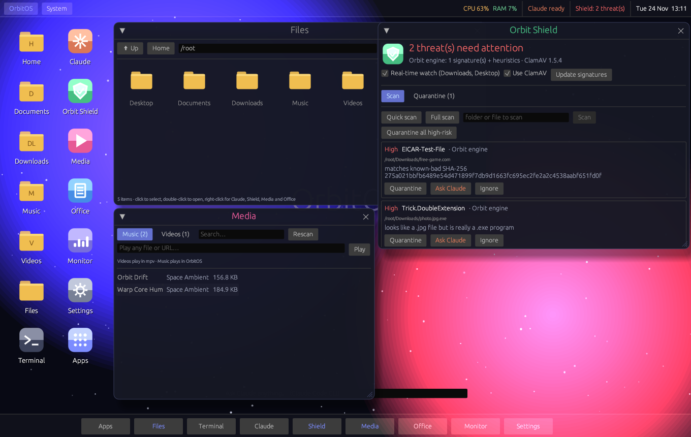

# OrbitOS

A desktop environment and shell written in Rust, with Claude built in.
One codebase runs on **Windows, Linux and macOS**, on any laptop that can run
a modern OS.

OrbitOS runs *on top of* your existing OS. It doesn't replace the kernel.
That's how it can run on any laptop, launch your existing Windows, Mac or
Linux apps, and use their drivers. On Linux it can also act as a full login
session, so it boots straight into OrbitOS.



## What's inside

| Crate | Binary | What it does |
|---|---|---|
| `orbit-core` | library | Settings, Claude backends, system info, app discovery, files, command execution |
| `orbit-shell` | `orbit` | Terminal shell: built-ins, Claude chat, `do` tasks, passthrough to the host shell |
| `orbit-desktop` | `orbit-desktop` | GUI desktop: clickable desktop icons, top bar, dock, and Files / Terminal / Claude / Orbit Shield / Media / Office / Monitor / Settings windows |

### Orbit Shield: built-in antivirus
Two engines work together:
- **Orbit engine** (built in, pure Rust): SHA-256 signatures (add your own in
  `signatures.txt` next to the config file, one `sha256 name` per line), the
  EICAR test file, file-name tricks (`photo.jpg.exe`, right-to-left override),
  and script heuristics (ransomware commands that delete backups,
  download-and-run, hidden or encoded PowerShell).
- **ClamAV** (open source, [github.com/Cisco-Talos/clamav](https://github.com/Cisco-Talos/clamav)):
  used automatically when installed. **Update signatures** runs `freshclam`.

Features: quick and full scans, scanning any file or folder (right-click in
Files), **real-time watch** of Downloads and Desktop, **quarantine** (files
are encoded so they can't run, and can be restored), and **Ask Claude** on
every finding for a plain-English explanation and advice.

### Media
- **Music** plays inside OrbitOS (MP3, FLAC, WAV, OGG, Opus, M4A/AAC) with
  play/pause, next/previous, seek and volume, from your Music and Downloads folders.
- **Video** plays in **mpv** ([github.com/mpv-player/mpv](https://github.com/mpv-player/mpv)),
  the leading free open-source player, with **VLC** as a fallback.

### Office
Uses **LibreOffice** ([github.com/LibreOffice/core](https://github.com/LibreOffice/core)), the free
open-source office suite: new documents, spreadsheets, presentations and
drawings, recent files, one-click **Convert to PDF**, and **Write with
Claude**. You describe a document, Claude writes it, and it's saved as a real
`.docx`, `.odt` or `.pdf` in `Documents/OrbitOS` and opened in LibreOffice.

### Claude integration (switchable)

| Backend | How it connects | Key stored? |
|---|---|---|
| **cli** (default) | Pipes the conversation to your signed-in Claude Code CLI (`claude -p`) | No |
| **api** | Streams from the Anthropic Messages API | Yes (`ANTHROPIC_API_KEY` or Settings) |
| **auto** | API if a key exists, otherwise CLI | – |

Switch in **Settings**, or run `backend cli|api|auto` in the shell.

Claude knows which OS and folder you're in. When it suggests a command, the
command appears with a **Run** button (desktop) or a `Run it? [y/N]` prompt
(shell). **Nothing runs until you confirm.**

## Install

1. Install Rust: <https://rustup.rs>
2. Recommended free tools (OrbitOS works without them and tells you what's missing):

   | | Windows | macOS | Linux (Debian/Ubuntu) |
   |---|---|---|---|
   | ClamAV | `winget install Cisco.ClamAV` | `brew install clamav` | `sudo apt install clamav` |
   | mpv | `winget install mpv` | `brew install mpv` | `sudo apt install mpv` |
   | LibreOffice | `winget install TheDocumentFoundation.LibreOffice` | `brew install --cask libreoffice` | `sudo apt install libreoffice` |

   Then run `freshclam` once (or click **Update signatures** in Orbit Shield).
3. For the CLI backend, install Claude Code and sign in once:
   ```
   npm install -g @anthropic-ai/claude-code
   claude
   ```
4. Build:
   ```
   cargo build --release
   ```
   The binaries are in `target/release/`: `orbit` and `orbit-desktop`
   (`.exe` on Windows).

### Platform notes
- **Linux**: needs X11 or Wayland, plus OpenGL (Mesa) and ALSA headers for
  music playback: `sudo apt install libxkbcommon-dev libgl1-mesa-dev libasound2-dev`.
  To build without in-app music: `cargo build --release -p orbit-desktop --no-default-features`
  (music then opens in mpv).
- **macOS**: works out of the box. Run `cargo build --release` in Terminal.
- **Windows**: install the "Desktop development with C++" workload from the
  Visual Studio Build Tools (Rust's MSVC toolchain needs it).

## Use

### Desktop
```
orbit-desktop              # windowed
orbit-desktop --fullscreen # takes over the screen, like an OS
orbit-desktop --show-all   # open Files, Shield and Media at start
orbit-desktop --open=office,claude   # choose which windows open
```
- **Desktop icons**: click to select, double-click (or Enter) to open
- **Files** shows folders as icons (or a list). Double-click opens folders,
  plays media and opens documents. Right-click gives Claude, Orbit Shield,
  Media and Office actions
- **Ctrl/Cmd + Space**: app launcher (searches your installed apps on every OS)
- **Ctrl/Cmd + K**: Claude
- In Files, right-click a file and choose **Ask Claude about this file**
- In Terminal, type `? question` to send it to Claude
- **Send system info** sends live CPU, memory and disk stats to Claude for a health check

### Shell
```
orbit                      # interactive
orbit ? what's using my RAM
```
| Command | Does |
|---|---|
| `? <question>` | Chat with Claude (it remembers the conversation) |
| `do <task>` | Claude writes the command; you confirm |
| `explain <file>` | Claude explains a file |
| `ls cd pwd cat open` | File basics |
| `scan [path]` | Orbit Shield scan; quarantine or ask Claude per finding |
| `quarantine` · `restore <id>` · `update-av` | Manage quarantine and ClamAV signatures |
| `music` · `videos` · `play <file>` | Media library and playback (mpv/VLC) |
| `office new <kind>` · `office open <file>` · `pdf <file>` | LibreOffice |
| `draft <topic>` | Claude writes a document, saved as .docx |
| `sys ps kill apps launch` | System and apps |
| `backend model key config` | Settings |
| anything else | Runs in cmd.exe / sh |

## Make it your session on Linux (boot into OrbitOS)
```
sudo cp target/release/orbit-desktop /usr/local/bin/
sudo cp packaging/orbitos.desktop /usr/share/xsessions/
```
Log out, pick **OrbitOS** on the login screen, and it starts fullscreen.

## Settings file
- Linux: `~/.config/orbitos/config.toml`
- macOS: `~/Library/Application Support/orbitos/config.toml`
- Windows: `%APPDATA%\orbitos\config.toml`

```toml
backend = "cli"            # cli | api | auto
model = "claude-sonnet-5-5"
max_tokens = 4096
fullscreen = false
# api_key = "..."          # optional; ANTHROPIC_API_KEY takes priority
# cli_path = "/path/to/claude"
```
A saved API key is stored in plain text. An environment variable is safer.

## Develop
```
cargo test --workspace
cargo run -p orbit-desktop
cargo run -p orbit-shell
```
GitHub Actions (`.github/workflows/ci.yml`) builds and tests on Windows,
macOS and Linux.

## Roadmap ideas
- Claude tool use: file edits and app control with per-action approval
- Orbit Shield: on-access scanning via OS file events, scheduled scans, YARA rules
- Embedded video (libmpv) inside the Media window
- Window manager mode on Linux (Wayland compositor via `smithay`)
- Notifications, clipboard history, a settings sync
- Voice input
- Plugins (WASM) for third-party widgets

MIT licensed.
